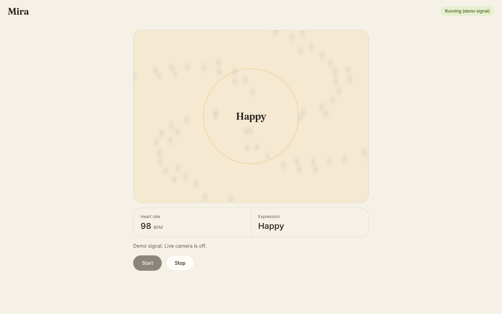

# Mira, a living mirror

Mira reads your pulse and expressions from your camera and shapes a living mirror: the scene tint follows your expression, the ring breathes at your heart's tempo. Built with the Presage SmartSpectra SDK (`@smartspectra/node-sdk`), Electron 43, and three.js. Most Creative / Delightful lane.



SmartSpectra tech used: `PULSE_RATE` + face metrics via the Node SDK, no diagnosis, no storage, no network calls with video.

## How to Test

No camera or key needed for the demo path:

```bash
cd electron
npm install
npm run start:mock
```

Click **Begin mirror**, then **Start**. The mirror cycles Neutral, Happy, Surprised, Sad with a demo pulse (60 to 100 BPM). Screenshots: `electron/screenshots/`. Clip: `electron/demo-mirror.mp4`.

Live camera path (needs a Presage key):

```bash
cd electron
MIRA_API_KEY=your_key_here npm run start
```

Or put `MIRA_API_KEY=your_key_here` in `electron/.env` (gitignored). Consent gate appears first; the camera never starts before Begin.

## Consent and Data Handling

- The camera never starts before you press Begin mirror.
- Frames never leave this device. Nothing is recorded, stored, or sent anywhere.
- Wellness feedback only, never a medical reading. The app makes no diagnosis or treatment claims.
- Weak signal states are surfaced honestly (no face, low confidence, camera denied).

## Repo layout

- `electron/` is the challenge app: main, preload, renderer, `living-scene.js` (three.js glow field), `mirror.js` (expression to mood map), `mock-signals.js` (demo source).
- `app/` is the untouched Next.js starter; out of scope for the SDK path, kept building.

## Judge checklist

- [ ] `cd electron && npm install && npm run start:mock` runs, Begin then Start shows the mirror
- [ ] Mood label changes as the demo cycles; ring tempo tracks BPM
- [ ] Consent gate blocks the camera until Begin
- [ ] Screenshots in `electron/screenshots/` match the live UI
- [ ] `electron/demo-mirror.mp4` plays (silent, 17s)
